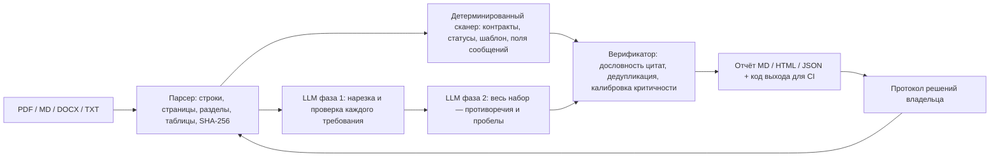

# ReqGuard

**ИИ-агент, который до старта разработки находит в ТЗ противоречия и пробелы, доказывает каждое дословной цитатой и задаёт владельцу требований точный вопрос, без которого задачу нельзя реализовать или протестировать.**

Задание BCC-HUB × MNU FinTech Hackathon. На входе PDF с текстовым слоем, Markdown, TXT или DOCX; на выходе отчёт на русском (MD, HTML, JSON) по ISO/IEC/IEEE 29148:2018 (пп. 5.2.5, 5.2.6) и IEEE Std 830-1998 (п. 4.3).

## Результат на документе задания

| | |
| :--- | :--- |
| Отчёт | [examples/579a4b8/report.md](examples/579a4b8/report.md) · [HTML](examples/579a4b8/report.html) · [JSON](examples/579a4b8/report.json) |
| Прогон | `docs/requirements.pdf`, 27.11.2026, `gemini-3.6-flash` (обе фазы), агент `v1.4.0 (579a4b8)`, тег `v1.4.0-submit`, 33 с; после этой версии в коде изменён только фильтр предложенных исправлений (`a7221af`). Повторный прогон даёт другое число замечаний — см. [разброс](eval/unseen/RESULTS.md#ограничения) |
| Итог | **Не готово к разработке и тестированию**: 21 требование, 20 замечаний, 8 критичных |
| Проверяемость | 58 из 58 цитат дословно совпадают с PDF (страница и строка); отклонённых записей модели — 0 |

Что агент нашёл и о чём спрашивает владельца (страница/строка PDF):

| Находка | Где | Вопрос владельцу из отчёта |
| :--- | :--- | :--- |
| Пример приёмки относит покупку 31 января к февралю, а правило Ф-2 — к месяцу совершения | с. 1 стр. 26; с. 2 стр. 44 | Какой источник следует исправить: правило выбора даты или ожидаемый результат? |
| «Максимум один push за месяц» (Ф-3) против «независимо от истории» (Ф-4) | с. 1 стр. 27–28 | При новом достижении настройки нужно ли отправить второе push по этой карте за месяц? |
| Приложение должно читать настройки, а контракт описывает только сохранение | с. 1 стр. 20; с. 3 стр. 78 | Каким описанным поведением контракта обслуживается получение текущих настроек? |
| Сохранение настройки через `GET` с query-параметрами | с. 3 стр. 78, 84 | Какой метод и контракт определяют чтение и сохранение настройки? |
| Секция `200` содержит тело `ERROR`, а для ошибок описан `400` | с. 4 стр. 128, 131, 136 | Какой HTTP-статус и формат тела должны возвращаться в этом случае? |
| Покупки хранятся в тиынах, порог — в тенге, правило приведения не описано | с. 1 стр. 27; с. 2 стр. 34 | В каких единицах выполняется сравнение и как приводятся величины? |
| Push передаёт «последние четыре цифры карты», источник значения не описан | с. 1 стр. 30; с. 2 стр. 34 | Откуда берётся это значение? |
| Заголовок `403`, а текст описывает возврат `404` | с. 4 стр. 139–140 | В каких случаях метод возвращает 403, а в каких 404? |

Полный список, сценарии для QA и альтернативы решений — в отчёте. Известная ошибка этого отчёта: DEF-A01 (CRITICAL) утверждает, что обработка возврата за прошлый месяц не задана, хотя Ф-2 относит возврат к месяцу исходной покупки; открытым остаётся другой вопрос — что делать с уже отправленным push. Критичность агента в целом завышена (см. сравнение ниже).

## Сравнение с одним запросом к той же модели

Незнакомый документ (перевод по номеру телефона, 11 дефектов размечены и закоммичены до прогонов), `gemini-3.6-flash`, по 4 прогона:

| | ReqGuard | Один запрос |
| :--- | :--- | :--- |
| Найдено дефектов из 11 (4 прогона) | 8, 9, 8, 8 | 6, 6, 5, 6 |
| Ложные замечания | 0–2 CRITICAL на прогон (завышенная критичность) | по 1 некритичному |
| Не нашли обе системы | код подтверждения в URL; сценарий «номер не найден» | то же |

На документе кейса — 9 из 9 контролей E1–E9 в обоих прогонах против 3 у одиночного запроса (на этом документе агент отлаживался). Разметка авторская, выборка маленькая, критичность агента завышена — подробности и все оговорки: [eval/unseen/RESULTS.md](eval/unseen/RESULTS.md).

## Цикл уточнения с владельцем

1. Агент формулирует вопрос без навязанного ответа; для конфликта двух правил — сценарий и обе альтернативы.
2. Владелец выбирает исход в HTML-отчёте или Studio и скачивает протокол решений (JSON с SHA-256 документа).
3. Повторный прогон `--answers decisions.json` сверяет протокол с документом и цитатами; принятые решения идут отдельным приложением, открытые вопросы продолжают блокировать готовность.

## Как устроен агент



- Модель предлагает, код проверяет: замечание без дословной цитаты отбрасывается; цитата привязывается к странице и строке исходника.
- Проверки, которые надёжно делаются без модели (статусы API, поля сообщений без источника, пустые разделы шаблона), выполняет сканер — их результат не зависит от ответа модели.
- Резервная цепочка моделей и честный паспорт: если анализ неполный, положительный итог не выдаётся (код 3).
- 93 автотеста, в том числе на независимых документах, не совпадающих с кейсом.

## Запуск

Требуется Python 3.10 или новее. Из корня репозитория:

```powershell
python -m venv .venv
.\.venv\Scripts\python.exe -m pip install -r requirements.txt
Copy-Item .env.example .env
```

Получите ключ в [Google AI Studio](https://aistudio.google.com/apikey). В локальном файле `.env` задайте `GEMINI_API_KEY` и `GEMINI_MODEL` — идентификатор модели, доступной вашему ключу. В конфигурации проекта выбран `gemini-3.6-flash`. Провайдеры OpenAI-совместимого API, Anthropic и Ollama также поддерживаются, примеры параметров приведены в `.env.example`. При облачном запуске текст документа передаётся выбранному провайдеру.

```powershell
.\.venv\Scripts\python.exe main.py docs/requirements.pdf reports/report.md --with-html --json reports/report.json
```

Второй аргумент задаёт путь к основному отчёту. В Linux/macOS используйте `.venv/bin/python`. Для локальной Studio выполните `python main.py --serve` в активированной среде. Открытие сохранённого отчёта показывает результат предыдущего прогона.

## Как проверить вывод

1. Парсер сохраняет строки, разделы, таблицы, номера страниц PDF и SHA-256 входного файла. Сканер ищет пропуски шаблона и несогласованные контракты. Для поддержанного вида календарной приёмки он сравнивает месяц события по правилу с названным в таблице счётчиком.
2. Первая фаза модели выделяет и проверяет требования, вторая сопоставляет каталог с документом. Каждый вывод ссылается на исходный фрагмент. Подлинность цитаты можно проверить по строкам. Смысл вывода и изменение продуктовой политики согласует аналитик.
3. Паспорт и итог показывают полноту анализа. Нулевое покрытие или незавершённый анализ не дают положительного решения о старте. Индекс при наличии оценки — внутренняя эвристика. Принимая решение, откройте доказательства каждого критического дефекта.

## Как показать решение владельцу продукта

Запустите `python main.py --serve` и откройте http://127.0.0.1:8080: главная страница сразу показывает сдаваемый отчёт (без ключа и без нового прогона) — вердикт, вопросы владельцу с цитатами и все замечания. Кнопка «Проверить другое ТЗ» загружает новый документ; результат откроется на той же странице. Тот же вид у файла report.html. У конфликта прочитайте обе цитаты, вопрос и сценарий. Выберите ожидаемый исход либо отложите решение. Кнопка «Скачать протокол решений» сохраняет вопросы, выбор, цитаты, проверку для QA и SHA-256 входа в отдельный JSON. В доступном локальном хранилище браузера выбранные варианты сохраняются для этого прогона. Для переноса между браузерами используйте экспорт JSON. Чтобы подтвердить устранение дефекта, внесите согласованную правку в копию ТЗ и повторите прогон.

Для репетиции возьмите конфликт между месячным ограничением и повторной отправкой после смены настройки. Затем измените ожидаемый месяц в строке календарной приёмки и проверьте, какое замечание исчезло. Парсер отмечает страницы PDF с графикой без извлечённого текста. В этом случае итоговый индекс скрыт, страницы перечислены в паспорте. Для сканов требуется текстовая копия. Иллюстрации внутри текстовых страниц агент семантически не проверяет.

Для повторной проверки передайте исходный файл и скачанный протокол:

```powershell
.\.venv\Scripts\python.exe main.py docs/requirements.pdf output/review.md --answers decisions.json --with-html
```

Studio принимает тот же JSON рядом с загрузкой ТЗ. Агент сверяет SHA-256, вопрос, вариант и точные места в документе с новым прогоном. Несовпавший выбранный ответ останавливает проверку. Подтверждённые решения входят в итог как отдельное приложение владельца. Отложенные вопросы остаются открытыми.

## Результат в CI

После записи отчёта CLI возвращает 0 при полном GO, 1 при полном NO-GO, 2 при ошибке входа, провайдера или записи и 3 при неполной оценке, в том числе в режиме `--structural-only`. В PowerShell код доступен в `$LASTEXITCODE`. Сборщик комплекта принимает полный NO-GO: вердикт относится к проверенному ТЗ.

Индекс — эвристика. Штраф равен 18 × CRITICAL + 7 × MAJOR + 2 × MINOR, индекс равен округлённому 6000 / (60 + штраф) с нижней границей 5. Пропущенная оценка показывается отдельно. Разрешение на старт определяется полнотой и тяжестью открытых замечаний.

## Сравнение с одним запросом

Для попарной проверки запустите `python compare_runs.py unseen.pdf output/pair` в активированной среде. Оба прогона используют снимок одного файла, один парсер, основную модель и одну температуру. Первый получает один запрос без результатов сканера, второй выполняет полный анализ. При недоступности модели эксперимент завершается с ошибкой. JSON содержит исходные замечания, ссылки на текст, длительность, HTTP-попытки и счётчики токенов, если их передал провайдер. Стоимость зависит от тарифа.

До прогона на новом документе попросите аналитика отдельно записать известные дефекты с цитатами и подготовить копию с исправлением одного дефекта. Для каждого результата посчитайте, сколько размеченных дефектов подтверждено, какие остались незамеченными и какие замечания ложные. Подлинность цитаты и правильность вывода проверяйте отдельно. По одному документу нельзя оценить точность на банковских ТЗ в целом.

## Репетиция и сдача

```powershell
.\.venv\Scripts\python.exe -m pytest -q
.\.venv\Scripts\python.exe main.py docs/requirements.pdf output/preview.md --structural-only
.\.venv\Scripts\python.exe prepare_submission.py docs/requirements.pdf output/submission
```

Предпросмотр выполняет только статический анализ. Последняя команда создаёт отдельный комплект после полного прогона с моделью: неизменённый вход, Markdown, HTML и JSON. Выберите новый выходной каталог. Организаторам передаются исходный документ и сгенерированный отчёт вместе со ссылкой на репозиторий. Внешняя сеть, ключ и доступ к модели проверяются на компьютере защиты. Старые материалы в `submission_ready` относятся к релизу, указанному в их паспорте.

## Проверка материалов защиты

Сдаваемый отчёт — полный прогон с моделью `gemini-3.6-flash` (обе фазы) на версии `v1.4.0 (579a4b8)`, собранный `prepare_submission.py`: [examples/579a4b8](examples/579a4b8/report.md) (также HTML и JSON). Отчёт предыдущей версии: [examples/c1f6e62](examples/c1f6e62/report.md). HTML-файл примера пересобран из его report.json шаблоном версии 4ced12c (меняется только оформление, содержимое — из прогона 579a4b8). Предыдущий пример: [examples/8d48b6a](examples/8d48b6a/report.md). Версия указана в паспорте каждого отчёта. Для дополнительной проверки замечаний с контрцитатами используйте флаг `--critic`. При сбое этого прохода CLI возвращает 3.

Для эксперимента есть отдельное ТЗ `eval/notice.md` и авторская разметка в `eval/keys/`. После двух парных запусков сравните файлы каждой пары командой `python eval/score.py eval/keys/notice.json output/pair/agent.json output/pair/single.json`. Для PDF кейса используйте ключ official.json. Счётчик показывает совместное присутствие контрольных цитат в одном замечании. Ложные блокеры, справедливость критики и правильность вывода проверяет человек. Например, в исходном НФТ начало отсчёта уже задано словами «после получения события».

Слайды по конкретному сохранённому отчёту: `python -m pip install python-pptx`, затем `python build_presentation.py output/submission/report.json output/submission`. Первый слайд содержит статус и версию прогона.
